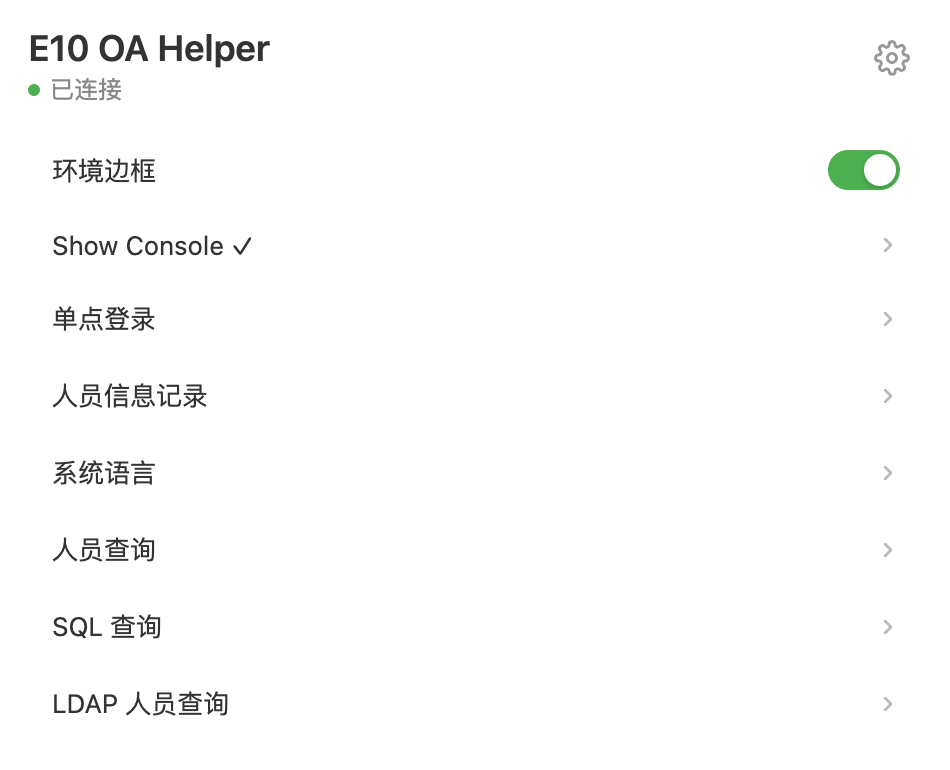
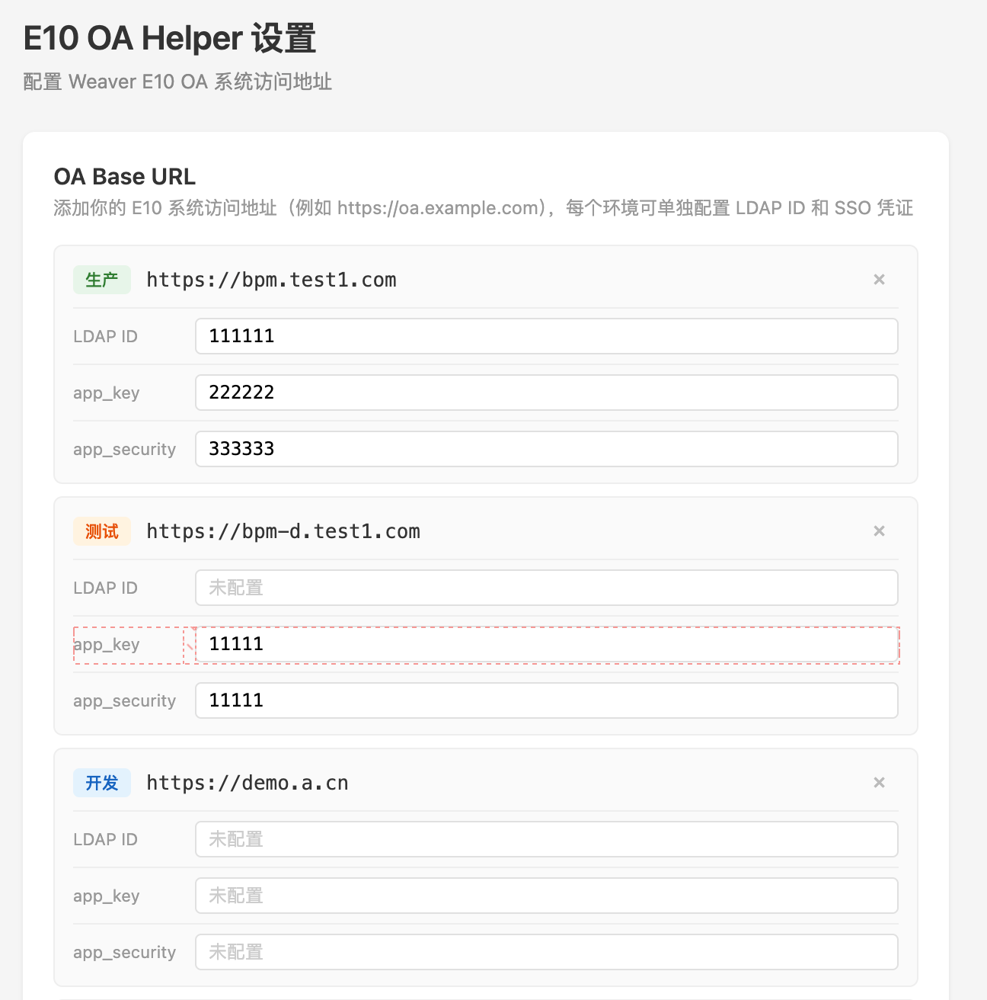

# Weaver E10 OA Helper

[](LICENSE)
[](manifest.json)

一个面向 Weaver E10 OA 的 Chrome 扩展（Manifest V3），把日常使用中最常用的页面操作收敛成 popup 里的快捷入口：环境标识、控制台开关、语言切换、人员查询、变更记录、实例日志、SQL 查询等。

> **A Chrome extension (MV3) that adds practical shortcuts to Weaver E10 OA. Unofficial, use at your own risk.**

> [!IMPORTANT]
> **非官方项目。** 本项目为个人开发的第三方工具，与 Weaver Network Technology Co., Ltd.（泛微网络科技股份有限公司）没有任何隶属、授权、赞助或支持关系。项目名称中的 "Weaver"、"E10" 仅用于说明适配对象，相关名称与商标归其各自权利人所有。

---

## 截图

命中已配置的 OA 地址时 popup 顶部显示「已连接」，功能菜单才会出现：



设置页按环境配置 OA 地址、LDAP ID 与 SSO 应用凭证：



---

## 功能

### 稳定功能

| 功能 | 入口 | 说明 |
| --- | --- | --- |
| 环境边框 | popup → 环境边框 | 在开发 / 测试 / 预发布环境页面叠加彩色全屏边框与角标，避免在生产环境误操作；生产环境不显示。 |
| Show Console | popup → Show Console | 自动在 OA 页面 URL 上追加 `wea_link_keep_show_console=1`（兼容 SPA 路由），随时调出页面自带控制台。 |
| 系统语言 | popup → 系统语言 | 读取并切换当前账号的界面语言，含 Beta 语言。 |
| 人员查询 | popup → 人员查询 | 按姓名 / 工号 / 邮箱 / 手机号 / 办公电话搜索通讯录，点击结果直达人员详情页。 |
| LDAP 人员查询 | popup → LDAP 人员查询 | 用配置的 LDAP ID 按过滤器查询目录条目，并查看条目属性；需先填写 LDAP ID。 |
| 人员信息记录 | 人员详情页 → popup → 人员信息记录 | 拉取该人员的字段变更日志，按字段聚合为「旧值 → 新值」，支持关键词过滤。 |
| 查看实例日志 | 动作流设计器 / 动作流执行日志页 → popup → 查看实例日志 | 直接唤起页面原生的「实例日志」弹窗（复用其时间范围、操作者、状态等筛选与分页）。 |
| 群组管理表格优化 | 自动生效 | 修正群组管理页表格列宽，以及群组名称多语言输入框过窄的问题。 |

### 实验性功能

> 以下功能依赖特定配置与 E10 页面结构，可能随 E10 版本升级失效或行为变化，建议先在测试环境验证。

| 功能 | 入口 | 说明 |
| --- | --- | --- |
| SQL 查询 | popup → SQL 查询 | 通过「数据中心 · 直连数据源」的 SQL 预览接口执行查询并展示结果；连接 ID 可在面板内修改（全局共享、不区分环境）；结果集最多渲染 200 行。 |
| 单点登录 | 人员详情页 → popup → 单点登录 | 用配置的 `app_key` / `app_security` 通过 OpenAPI 获取登录 Token，并在无痕窗口打开 SSO 链接。 |
| 重新执行动作流 | 动作流执行日志页 → popup → 重新执行动作流 | 按当前 `application` / `logId` 以执行模式重新触发一次动作流。 |
| ESB 日志 checkbox 解锁 | 开启 Show Console 后自动生效 | 解除 e-builder 动作流日志表格中 checkbox 的禁用状态，便于批量选择。 |

内容脚本与 MAIN world 脚本会注入所有页面，但功能逻辑仅在当前页面 URL 命中「设置」中已配置的 OA 地址时启用（按域名与路径边界匹配，不是字符串前缀匹配）。

## 安装

前置要求：Chrome 111+（内容脚本 `world: "MAIN"` 需要，manifest 中已声明 `minimum_chrome_version`）。

1. 克隆或下载本仓库。
2. 打开 `chrome://extensions`，右上角开启「开发者模式」。
3. 点击「加载已解压的扩展程序」，选择本仓库根目录（含 `manifest.json` 的那一层）。
4. 建议将扩展固定到工具栏，方便查看状态绿点。

如需分发包或上架，只打包运行所需文件即可：

```bash
zip -r weaver-e10-oa-helper-0.1.0.zip manifest.json background content lib popup options icons LICENSE README.md
```

## 配置

点击扩展图标 → 右上角设置按钮，进入设置页：

| 配置项 | 必填 | 说明 |
| --- | --- | --- |
| OA Base URL | 是 | 你的 E10 访问地址，例如 `https://oa.example.com`。可分别添加开发 / 测试 / 预发布 / 生产多个环境，地址决定该环境的功能启用与边框颜色。 |
| LDAP ID | 否 | 「LDAP 人员查询」使用，可在 OA 的 LDAP 集成配置中查看。 |
| `app_key` / `app_security` | 否 | 「单点登录」使用，在 OA 的 OpenAPI / 集成中心创建应用后获取。 |

SQL 连接 ID 不在设置页，而是在 popup 的「SQL 查询」面板内填写；该值全局保存、不区分环境，切换环境后请重新确认连接 ID 属于当前环境。

「单点登录」以无痕窗口打开 SSO 链接，需要先在 `chrome://extensions` → 本扩展详情中开启「允许在隐私模式下使用」，否则无法打开。

所有配置仅保存在本机 `chrome.storage.local`，扩展不会主动上传。

## 权限说明

| 权限 | 用途 |
| --- | --- |
| `storage` | 保存上述本地配置与开关状态。 |
| `tabs` / `activeTab` | 读取所有标签页的 URL，用于判断是否为已配置的 OA 页面并更新角标（不保存、不上传）；打开人员详情页、SSO 窗口。 |
| `scripting` | 当页面未加载内容脚本时，按需注入回退的 `message-bridge.js`。 |
| `windows` | 以无痕窗口打开 SSO 链接。 |
| `<all_urls>`（内容脚本 / MAIN world） | OA 地址由使用者自行配置，无法在清单中预先声明，因此脚本会注入所有页面；功能逻辑仅在 URL 命中已配置的 OA 地址时启用。 |

## 隐私与数据

- 无统计上报、无远程配置、无第三方服务；扩展不发起任何与 OA 无关的网络请求。
- 配置只保存在本机 `chrome.storage.local`，扩展不会主动上传；只有在你使用「单点登录」「SQL 查询」等功能时，该功能所需的参数（如 `app_key` / `app_security`、SQL 语句、连接 ID）才会随请求发送到你自行配置的 OA 地址。
- 所有接口请求只发往已配置的 OA 地址，并携带浏览器已有的 OA 登录 Cookie（`credentials: 'include'`），不经过任何中转服务。
- 配置未加密存储，共用设备的场景请自行评估；卸载扩展即清除。
- 仓库不包含任何真实 OA 地址、账号、密钥、客户或人员数据；Git 提交元数据中的作者姓名与邮箱除外。

## 合规与安全

- 本项目仅限用于**你拥有或已获得明确授权**的 E10 环境。使用者应自行确保使用方式符合所在组织的信息安全规范、与客户的合同约定以及当地法律法规。
- 所有接口请求均经 OA 后端鉴权后执行；其中单点登录使用 OA OpenAPI 的应用凭证换取登录 Token，`app_key` / `app_security` 由使用者自行申请与配置。
- SQL 查询通过数据中心的 SQL 预览接口执行，用于只读查询；实际可访问的数据取决于所配置数据源账号的权限。
- 「单点登录」「SQL 查询」「重新执行动作流」「ESB 日志 checkbox 解锁」依赖特定配置或页面结构，可能随 E10 版本升级失效或行为变化，建议先在测试环境验证。
- 请勿将真实环境地址、账号、密钥、人员数据或系统截图提交到本仓库；提 Issue 时请先脱敏。
- 作者不对使用本工具造成的任何直接或间接损失负责，详见 [LICENSE](LICENSE)。

## 已知限制

- 功能依赖 E10 前端页面结构与部分内部接口，E10 版本升级后可能需要同步适配；不同版本 / 补丁环境的表现可能不一致。
- 安装或更新扩展前已打开的页面不会自动获得内容脚本，依赖内容脚本的功能（环境边框、实例日志等）需要刷新页面后才生效。
- 「查看实例日志」依赖页面按钮文案（「执行实例」/「更换实例」），把 E10 界面切换为其它语言后可能找不到入口。
- 「人员信息记录」一次最多拉取最近 100 条变更日志；记录较多时并发拉取详细变更，耗时较长。
- 没有自动化功能测试；CI 仅做 JS 语法、manifest 校验与硬编码密钥扫描，手动验证流程见 [AGENTS.md](AGENTS.md)。

## 项目结构

```
manifest.json                  MV3 清单：权限与入口
background/service-worker.js   角标与服务入口
content/content.js             内容脚本：Show Console、语言、LDAP、SSO、人员记录、SQL、实例日志
content/message-bridge.js      按需注入的消息回退桥接（与 content.js 的处理逻辑重复）
content/inject.js              MAIN world 脚本：解锁 ESB 日志表格 checkbox
content/content.css            注入到 OA 页面的样式
lib/utils.js                   共享工具（E10Utils）：OA 请求、存储、地址匹配
popup/                         popup 界面
options/                       设置页：按环境管理 OA 地址与凭证
icons/                         图标（16 / 32 / 48 / 128）
docs/screenshots/              README 与博客使用的功能截图
.github/workflows/             CI：JS 语法、manifest 校验、硬编码密钥扫描
```

无构建步骤：修改后在 `chrome://extensions` 中点击刷新即可。开发约定见 [AGENTS.md](AGENTS.md)，协议见 [LICENSE](LICENSE)。

## 贡献

欢迎 Issue / PR。提交前请确认：

1. 不包含真实环境地址、凭证、人员数据；
2. `content/content.js` 与 `content/message-bridge.js` 的消息处理保持同步；
3. popup / options 的 `escapeHtml` / `escapeAttr` 保持同步；
4. CI（JS 语法、manifest 校验、密钥扫描）通过。

## 许可证

[MIT](LICENSE) © 2026 E10 Helper Contributors

图标为本项目自制，未使用泛微的商标或素材。
